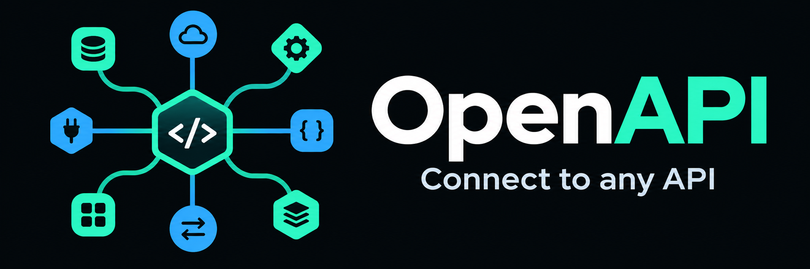

# PI Open API



An open-source PI and OMP extension for the RYZR AI Gateway and other compatible APIs. It discovers the current model inventory from the standard OpenAI-compatible `GET /v1/models` endpoint whenever the agent refreshes its model catalog. Optional `GET /model/info` metadata improves context-window and cost information but is not required.

Pi requests include the Pi session ID in `x-session-id` when available, so compatible gateways can group requests by conversation. Message content is recorded only when the gateway has content capture enabled.

The provider supports Pi's native incremental text/reasoning stream, tool calls, rich model metadata, and per-turn token and cost display. Non-streamed requests use the gateway's exact `x-asg-response-cost` value; streamed requests use the live usage event and current gateway model pricing. Post-response guardrails or transforms may intentionally buffer an answer until it has passed inspection.

No API key, CA certificate, certificate key, logs, prompts, or model inventory is stored in this repository. Each device stores its own credential in the agent's local credential store.

## Requirements

- Pi 0.81.0 or newer, or OMP 17.2.12 or newer
- Node.js 22.19.0 or newer
- An active API key with model-list and inference access

## Install in PI

Install directly from the public GitHub repository:

```bash
pi install https://github.com/ryzrTech/pi-open-api
```

No GitHub account or GitHub CLI authentication is required. The command is the same on macOS and Linux.

## Sign in

Start PI and run:

```text
/login OpenAPI
```

Enter the gateway URL without `/v1`, followed by a virtual key. For example:

```text
https://api.ryzrtech.com
```

Then use `/model` and choose a model under **OpenAPI**. Newly published models appear automatically after PI refreshes its model catalog or restarts.

The extension uses the operating system's normal TLS trust by default. To use a private gateway CA, set `OPENAPI_CA_CERT` to its absolute PEM path before starting PI. The extension keeps TLS verification enabled and does not modify the operating system trust store.

Sign-in validates the gateway URL and virtual key against the live model inventory before saving the credential. After signing in, run the live verification:

```bash
plugin_dir="$HOME/.pi/agent/git/github.com/ryzrtech/pi-open-api"
"$plugin_dir/scripts/verify-pi.sh"
```

Environment variables are also supported for unattended installations:

```bash
export OPENAPI_BASE_URL="https://api.ryzrtech.com"
export OPENAPI_API_KEY="sk-your-api-key"
```

Never commit either value to this repository or a shell profile synchronized to an untrusted system.

## Update

Update all installed PI extensions:

```bash
pi update --extensions
```

Or update only this extension:

```bash
pi update --extension https://github.com/ryzrTech/pi-open-api
```

Restart Pi after an update. This version uses `OpenAPI` as its Pi provider ID so it appears as `(OpenAPI)` in the status line. Pi stores credentials and default models by provider ID: after updating, run `/login OpenAPI` and select your model again. Existing `openapi` credentials are not deleted. OMP continues to use `openapi`.

## Post-install checks and known integration points

Run these checks after a fresh install, update, or credential change:

```bash
node --version
pi --version
pi --list-models OpenAPI
plugin_dir="$HOME/.pi/agent/git/github.com/ryzrtech/pi-open-api"
"$plugin_dir/scripts/verify-pi.sh"
```

The verifier must discover at least one model and complete a live inference that returns `PI_OPENAPI_OK`. A successful `/login` alone is not sufficient evidence that model discovery and inference both work.

### Troubleshooting symptoms

| Symptom | What to inspect |
|---|---|
| `SELF_SIGNED_CERT_IN_CHAIN` or `self-signed certificate in certificate chain` | Configure the gateway CA with `OPENAPI_CA_CERT`, or add it through your normal system trust process. Never use `NODE_TLS_REJECT_UNAUTHORIZED=0`. |
| `401 invalid API key` | Run `/login OpenAPI` in Pi again with an active key. A pasted key may be truncated, expired, revoked, or belong to another gateway. The current sign-in flow validates `/v1/models` before saving. |
| `No models available` after sign-in | Run `pi --list-models OpenAPI` and the verifier. Check the CA first, then the credential, and confirm this provider extension is actually loaded. PI may summarize an underlying refresh failure as an empty model list. |
| `No API key found for the selected model` from `pi-hermes-memory` | Hermes consolidation starts an isolated child PI process with `--no-extensions`. Add this provider's absolute extension entry path to Hermes `childExtensionPaths`; see below. |
| `pi: command not found` over SSH while PI works interactively | The Node/NVM path is probably initialized only by the interactive shell. Run the diagnostic through the login shell (for example, `zsh -lic 'pi --version'`) or configure a stable executable path. This is a host PATH issue, not a provider-auth failure. |

### pi-hermes-memory auto-consolidation

Automatic over-capacity consolidation runs in a child PI process that intentionally excludes packages from the parent `settings.json`. Pi credentials use the `OpenAPI` provider ID in this version; the child must also load this provider implementation.

Add an absolute provider entry path to `~/.pi/agent/hermes-memory-config.json`:

```json
{
  "llmModelOverride": "OpenAPI/ornith-1.5:35b",
  "llmThinkingOverride": "off",
  "childExtensionPaths": [
    "/absolute/path/to/pi-open-api/src/index.js"
  ]
}
```

For a PI-managed GitHub installation, the entry is normally below:

```text
~/.pi/agent/git/github.com/ryzrtech/pi-open-api/src/index.js
```

Use the fully expanded absolute path in JSON; `~` and `$HOME` are not shell-expanded there. For a local checkout, use that checkout's `src/index.js`. Choose a model currently returned by `pi --list-models OpenAPI`, preserve any other existing Hermes settings, and restart PI after changing the configuration.

### Maintenance follow-ups

- [ ] Decide whether to add an opt-in configurator for `pi-hermes-memory` instead of requiring a manual `childExtensionPaths` entry.
- [ ] Add coverage for invalid, revoked, and truncated virtual keys so login errors remain explicit.
- [ ] Verify installation and diagnostics under NVM-managed Node installations where non-interactive SSH shells have a reduced `PATH`.

## OMP (Oh My Pi)

For the complete Ubuntu/Zorin handoff, including a copy-paste block for another agent, see [INSTALL-OMP.md](./INSTALL-OMP.md).

OMP uses the native `omp.extensions` entry in this same package. Link a local checkout during development:

```bash
omp plugin link /absolute/path/to/pi-open-api
```

For a durable install, clone the public repository and run the bundled installer:

```bash
install_dir="${XDG_DATA_HOME:-$HOME/.local/share}/openapi/pi-open-api"
git clone https://github.com/ryzrTech/pi-open-api.git "$install_dir"
"$install_dir/scripts/install-omp.sh"
```

The OMP provider checks credentials in this order: `OPENAPI_OMP_API_KEY`, `OPENAPI_API_KEY`, and an OMP credential stored for `openapi`. No key is written to the plugin or model cache.

To store a dedicated credential, start OMP and run:

```text
/login openapi
```

The default gateway is `https://api.ryzrtech.com`. Override it with `OPENAPI_BASE_URL` when needed. For a gateway that uses a private CA, set `OPENAPI_CA_CERT` to the absolute path of your own CA certificate. No CA certificate is bundled with the plugin.

OMP 17.2.12 has a startup parsing bug for exact dynamic model selectors containing an Ollama tag colon. Use a unique colon-free selector such as `openapi/e2b` at startup, or choose the exact tagged model from OMP's interactive model picker after discovery. This workaround can be removed after OMP fixes its pre-discovery selector parsing.

After signing in, finish the configuration and run the live verification:

```bash
plugin_dir="${XDG_DATA_HOME:-$HOME/.local/share}/openapi/pi-open-api"
"$plugin_dir/scripts/install-omp.sh" --set-default
"$plugin_dir/scripts/verify-omp.sh"
```

## Remove

```bash
pi remove https://github.com/ryzrTech/pi-open-api
```

Removing the extension does not automatically delete credentials stored under `OpenAPI` or the previous `openapi` provider ID.

## Development and verification

```bash
npm test
pi install .
./scripts/verify-pi.sh
```

The provider uses `/v1/models` as the authoritative inventory, deduplicates model IDs, routes inference through `/v1/chat/completions`, and uses safe model defaults when richer metadata is unavailable. Tests also cover exact-cost attribution and the fallback to Pi's calculated cost when an exact response header is unavailable.

## License

[MIT](./LICENSE)
